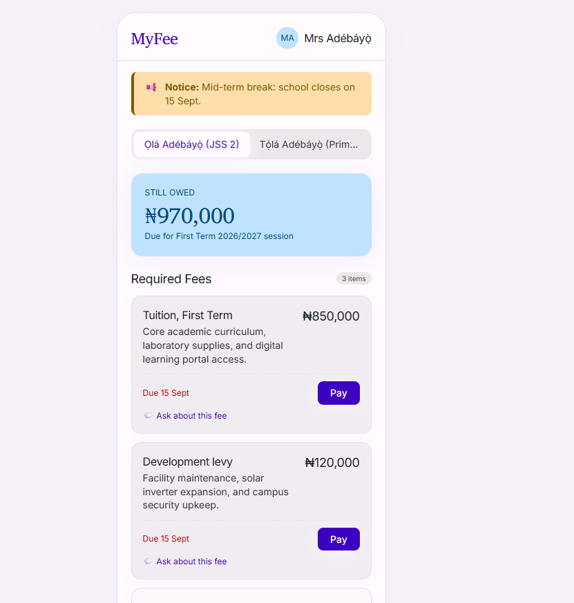

# Task 1: Design System

## What this task was

Build a design system for MyFee, a school fees portal for private schools in Abuja. The system covers colour, typography and shadows. It is exported as tokens, turned into CSS by an agent, and tested on a real screen.

## What I built

| Part | Where |
|-|-|
| Business brief | [docs/business-brief.md](docs/business-brief.md) |
| Colour system: brand colour, palettes, 39 colour roles, contrast ratios | [docs/colour-roles.md](docs/colour-roles.md) |
| Type scale: 15 styles | [docs/type-scale.md](docs/type-scale.md) |
| Divergences from the Material defaults | [docs/divergences.md](docs/divergences.md) |
| Three brand-coloured shadows | [docs/shadows.md](docs/shadows.md) |
| Token export (JSON) | [evidence/tokens-complete.json](evidence/tokens-complete.json) |
| Script that turns the JSON into CSS | [scripts/convert-tokens.js](scripts/convert-tokens.js) |
| Generated CSS variables | [styles/tokens.css](styles/tokens.css) |
| Fees screen built with the system | [screens/fees-with-system.html](screens/fees-with-system.html) |
| Prompts I gave the agent | [docs/prompts.md](docs/prompts.md) |

## What I decided

- **Brand colour `#3D00C2`, pinned at primary 40.** Without pinning, the generator put a lighter violet at tone 40 and my brand colour was not in the palette at all.
- **Charis SIL for display and headline, Inter for everything else.** Charis SIL keeps MyFee from looking generic and has a real ₦ sign. Inter keeps fee names, amounts and buttons clear on small phones.
- **120% line height on the serif, 140% on the sans serif.** At 140%, a Charis SIL heading that wraps looks like two separate blocks. This breaks the course formula on purpose and is explained in divergences.md.
- **Shadows built from the brand colour, not black.** Each shadow has its own colour role, so it changes with light and dark mode.
- **Roles point at primitives, never at hex values.** The interface only uses colour roles. Primitives only exist to feed the roles.

## Token export

The first export ([evidence/tokens-incomplete.json](evidence/tokens-incomplete.json)) had fonts, effects and typography but no colours, because I had not selected Figma variables. I noticed when I read the JSON and found no colour tokens, so I exported again with variables included.

## Proof the agent used the system

- The same fees screen was built twice: [without the system](evidence/09-screen-without-system.png) and [with it](evidence/10-screen-with-system.png).
- A search for raw colour values found none in the screen built with the system: [evidence/07-raw-value-search.txt](evidence/07-raw-value-search.txt).
- I asked the agent which typography style it used and checked its answer against the code: [evidence/08-agent-typography-answer.txt](evidence/08-agent-typography-answer.txt).

## Deliberate regression

When the colour roles point to primitives, a brand change only needs one edit at the source, and every role that uses it updates automatically. When I pointed the Primary role at a raw hex instead, it stopped following the palette, so changing the brand colour left the Pay buttons in the old violet while the "Still owed" card turned blue. If a school changed its brand colour and some roles were hard-coded like this, each one would have to be found and fixed by hand, and any that were missed would ship in the wrong colour with nothing to warn us.

The branch was deleted without merging: [evidence/12-git-log-branch-unmerged.txt](evidence/12-git-log-branch-unmerged.txt).

## What I got wrong

- **D1: My colour roles pointed at the palette from before pinning.** The Pay button would have shipped in a lighter violet, not the brand colour. I caught it because white text on primary measured 6.4, when it should have been about 10.6.
- **D2: My first full token export only had dark mode.** The plugin exported one mode per collection. I caught it when I saw primary pointing at P70 instead of P40, and switched to TokensBrücke, which exports both modes.

Both are written up in [docs/defects.md](docs/defects.md).
