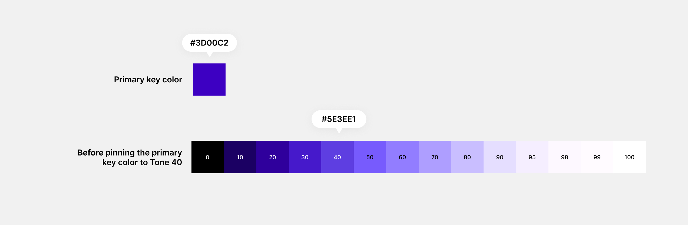
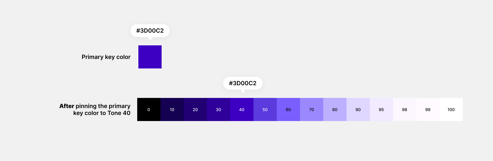

# Colour Roles

MyFee's colour system: where the brand colour came from, how the palette was built around it, what each colour role is for, and the contrast ratio for every pair the interface actually uses.

Built in Figma with the Figma Agent paired with context from the Google Material Theme Builder.

---

## 1. Brand colour

|||
|-|-|
|Key colour|`#3D00C2`|
|Where it came from|I picked a deep purple color from the Figma color picker, and this was inspired by the sector we are building for.  Ideally, I wanted to pick a cool color. Blue seemed generic. I opted for deep teal, but it felt too corporate, so I picked purple because it felt calm, not too generic and not too vibrant either.|

---

## 2. Pinning the brand colour to primary 40

|Before pinning|After pinning|
|-|-|
|||
|Tone 40: `#5E3EE1`|Tone 40: `#3D00C2`|

**What changed:**

I observed that the tonal palette generator used a visibly lighter fill for my primary 40 and completely eliminated my key color from the palette. This was because my key color had a tone of 26.41, which is visibly darker.
Based on the strict HCT lightness stops, primary 40 was supposed to be lighter, and my key color wasn't.

When I asked the agent to pin my key color to primary 40, it had to deviate from the strict HCT guide, use my key color as primary 40, then regenerate the rest of the palettes to complement.

---

## 3. Tonal palettes

|Palette|Source colour|Tones generated|
|-|-|-|
|Primary|`#3D00C2` (pinned at 40)|0, 10, 20, 30, 40, 50, 60, 70, 80, 90, 95, 98, 99, 100|
|Neutral + Extended|`#79767A` (pinned at 50)|0, 4, 6, 10, 12, 17, 20, 22, 24, 30, 40, 50, 60, 70, 80, 87, 90, 92, 94, 95, 96, 98, 99, 100|
|Neutral variant + Extended|`#79757F` (pinned at 50)|0, 4, 6, 10, 12, 17, 20, 22, 24, 30, 40, 50, 60, 70, 80, 87, 90, 92, 94, 95, 96, 98, 99, 100|

**Why this many tones is enough for light and dark from one source:**

Each palette covers the full range from 0 (black) to 100 (white), so light and dark mode don't need separate palettes or a second generator. Light mode uses dark tones for text and light tones for backgrounds, and dark mode swaps them. For example, on surface is N10 in light mode and N95 in dark mode, both from the same neutral palette.

The neutral palette had to be extended because I realized at some point that some tokens in dark mode required more shades of the neutral color, which weren't part of the initial 14-tone palette. For example, 'surface container' in dark mode uses the neutral 12 tone from the extended palette.

---

## 4. Functional colours

|Purpose|Key colour|Tone used in light|Tone used in dark|Where it appears in MyFee|
|-|-|-|-|-|
|Error|#D90101|40|70|Failed payment, form errors|
|Info|#E3A41C|40|70|Notices (e.g. fee due soon)|
|Success|#00AC14|40|70|Fee paid, receipt ready, success messages|

**Why these colours sit well next to the brand violet:**
None of the functional colors can be confused with the brand primary color. An element with the primary 40 tone will mostly be recognized as a CTA or an emphasized element, while elements with any of the functional colors are recognized and viewed according to their action roles.

---

## 5. Colour roles

A role is a job, not a colour. The interface uses roles only, never raw palette tones.

**Key:** P = Primary, N = Neutral, NV = Neutral variant, E = Error, S = Success, I = Info. The number is the tone, so P40 means primary tone 40. All 39 roles live in the Figma "Color roles" collection and point at the "Primitive colors" collection (110 variables).

### Primary

|Role|Job|Light Mode|Dark Mode|
|-|-|-|-|
|Primary|Pay button, emphasized active states.|P40|P70|
|On primary|Text and icons on primary|P100|P10|
|Primary container|Lower-emphasis brand areas|P90|P20|
|On primary container|Text and icons on primary container|P30|P80|
|Primary fixed|Brand fill that stays the same in light and dark|P90|P90|
|On primary fixed|Text and icons on primary fixed|P10|P10|
|Primary fixed dim|Stronger version of primary fixed|P80|P80|
|On primary fixed variant|Lower-emphasis text on primary fixed|P30|P30|
|Inverse primary|Primary-coloured actions on an inverse surface|P80|P80|

### Error

|Role|Job|Light Mode|Dark Mode|
|-|-|-|-|
|Error|Failed payment, form errors|E40|E70|
|On error|Text and icons on error|E100|E10|
|Error container|Error banner background|E90|E20|
|On error container|Text and icons on error container|E30|E80|

### Success

|Role|Job|Light Mode|Dark Mode|
|-|-|-|-|
|Success|Fee paid, receipt ready, success states and messages|S40|S70|
|On success|Text and icons on success|S100|S10|
|Success container|"Paid" badge background|S90|S20|
|On success container|Text and icons on success container|S30|S80|

### Info

|Role|Job|Light Mode|Dark Mode|
|-|-|-|-|
|Info|Notices (e.g. fee due soon)|I40|I70|
|On info|Text and icons on info|I100|I10|
|Info container|Notice background|I90|I20|
|On info container|Text and icons on info container|I40|I80|

### Surfaces

|Role|Job|Light Mode|Dark Mode|
|-|-|-|-|
|Surface|Page background|N99|N6|
|On surface|Main text, ₦ amounts, due dates|N10|N95|
|Surface variant|Alternative background|N95|NV10|
|On surface variant|Secondary text (fee descriptions)|NV20|NV90|
|Surface container highest|Highest-emphasis container|N90|N20|
|Surface container high|Higher-emphasis container (e.g. dialogs)|N92|N17|
|Surface container|Cards (e.g. a fee card)|N94|N12|
|Surface container low|Lower-emphasis container|N96|N10|
|Surface container lowest|Lowest-emphasis container|N98|N0|
|Inverse surface|Snackbars and toasts|N20|P90|
|Inverse on surface|Text on inverse surface|N95|P10|
|Surface tint|Tint applied to raised surfaces|P50|P80|

### Lines and overlays

|Role|Job|Light Mode|Dark Mode|
|-|-|-|-|
|Outline|Decorative input borders and dividers. Input fields are identified by their surface colour fill, not the outline.|NV80|NV50|
|Outline variant|Decorative dividers|N90|NV20|
|Scrim|Dark overlay behind dialogs|N10|N10|
|Shadow soft|Soft shadow (e.g. fee cards)|P98|NV6|
|Shadow medium|Medium shadow|P95|NV4|
|Shadow hard|Hard shadow (e.g. dialogs)|P90|NV0|

---

## 6. Contrast ratios

Checked with: WebAIM Contrast Checker at webaim.org/resources/contrastchecker

Pass marks: **4.5** normal text, **3.0** large text and icons, **7.0** AAA.

### Light mode

|Foreground|Background|Used for|Ratio|Needed|Pass?|
|-|-|-|-|-|-|
|On primary (P100)|Primary (P40)|Pay button label|10.61|4.5|Yes|
|On primary container (P30)|Primary container (P90)|Text and icons on primary container|9.63|4.5|Yes|
|On surface (N10)|Surface (N99)|Body text, ₦ amounts|16.73|4.5|Yes|
|On surface variant (NV20)|Surface (N99)|Fee descriptions|12.81|4.5|Yes|
|Primary (P40)|Surface (N99)|Links, active tab label|10.36|4.5|Yes|
|Outline (NV80)|Surface (N99)|Input borders (decorative)|1.25|Decorative|N/A|
|On error (E100)|Error (E40)|Text and icons on error|6.47|4.5|Yes|
|On error container (E30)|Error container (E90)|Error banner|7.24|4.5|Yes|
|Error (E40)|Surface (N99)|Inline error text|6.32|4.5|Yes|
|On success container (S30)|Success container (S90)|"Paid" badge|7.25|4.5|Yes|
|On info (I100)|Info (I40)|Text and icons on info|6.49|4.5|Yes|
|On info container (I40)|Info container (I90)|Notice text|5.03|4.5|Yes|
|||||||

### Dark mode

|Foreground|Background|Used for|Ratio|Needed|Pass?|
|-|-|-|-|-|-|
|On primary (P10)|Primary (P70)|Pay button label|6.42|4.5|Yes|
|On primary container (P80)|Primary container (P20)|Text and icons on primary container|8.19|4.5|Yes|
|On surface (N95)|Surface (N6)|Body text, ₦ amounts|16.3|4.5|Yes|
|On surface variant (NV90)|Surface (N6)|Fee descriptions|14.31|4.5|Yes|
|Primary (P70)|Surface (N6)|Links, active tab label|6.48|4.5|Yes|
|Outline (NV50)|Surface (N6)|Input borders and dividers|4.11|3.0|Yes|
|On error container (E80)|Error container (E20)|Error banner|7.71|4.5|Yes|
|Error (E70)|Surface (N6)|Inline error text|8.07|4.5|Yes|
|On success container (S80)|Success container (S20)|"Paid" badge|7.69|4.5|Yes|
|On info container (I80)|Info container (I20)|Notice text|7.75|4.5|Yes|
|||||||

### Pairs below the threshold

|Pair|Ratio|What I did|Reason|
|-|-|-|-|
|Outline (NV80) + Surface (N99) - Light|1.25|This pair is not used for text but decorative outlines only. Input fields are identified by their surface colour fill, not the outline.|I want the outlines to be soft and mostly decorative to avoid a neo brutalist interface.|
